# Property News Root-Cause Investigation

## 1. Executive Summary

This investigation is based on repository code, migration files, workflow definitions, and the prior incident reports already checked into the repo. It is not a live production audit and no database write or production reconfiguration was performed.

The strongest confirmed production issue in the available evidence is a collector defect in the robots.txt handling path. In the earlier incident report, the source fetch path raised `NameError: name 'source' is not defined` before the feed or source page could be fetched. That defect is documented in [docs/property-news/NEWS_ABSENCE_INVESTIGATION_2026-10-02.md](../../docs/property-news/NEWS_ABSENCE_INVESTIGATION_2026-10-02.md) and the corresponding code path is in [property-news/app/collector.py](../../property-news/app/collector.py). The current repository version shows the functional fix: `_robots_allowed()` now accepts the `Source` instance and uses it when creating the redirect guard. The fix is present in the checked-in code but deployment to Render cannot be verified from this workspace alone.

The second issue is operational, not merely code: the scheduled GitHub Action checks only the HTTP status of the collection endpoint. It does not prove that the collection result contains successful article ingestion. The workflow validates JSON fields, but the endpoint may return HTTP 200 while source collection still fails or is partial. This is described in both [docs/property-news/NEWS_ABSENCE_INVESTIGATION_2026-10-02.md](../../docs/property-news/NEWS_ABSENCE_INVESTIGATION_2026-10-02.md) and [.github/workflows/property-news-collector.yml](../../.github/workflows/property-news-collector.yml).

This means the evidence supports a combined scenario: a real collection outage caused by the robots.txt bug, plus a workflow/telemetry gap that made the failure easy to miss. The repo does not provide live production database counts in this workspace, so the investigation cannot conclusively prove whether a second DB issue existed at the same time. The most defensible conclusion is: Scenario A (job not running reliably or job fails before discovery) and Scenario H (multiple failures interacting) are both plausible, but the strongest confirmed cause is a source-level collector defect that prevents fetches before article discovery.

### Most likely root-cause classification

- Confirmed defect: `SourceCollector._robots_allowed()` was referencing an undefined `source` during robots processing. This blocked feed discovery.
- Strongly supported operational issue: Workflow success criteria relied on HTTP 200, not actual collection success.
- Plausible broader issue: Scheduler timing or deployment drift may have contributed, but the repo does not prove a separate scheduler failure.
- Investigation gap: No live Postgres or Render log access was available from this workspace, so database write failures and current production counts cannot be independently confirmed here.

## 2. Incident Scope and Timeline

### Timeline summary

| Date | Observation | Evidence |
| --- | --- | --- |
| 2 Oct 2026 | Prior investigation records a confirmed outage: all 135 active production sources stale; no items fetched in preceding 48 hours; latest published item was 29 Sep 2026 13:20 UTC. | [docs/property-news/NEWS_ABSENCE_INVESTIGATION_2026-10-02.md](../../docs/property-news/NEWS_ABSENCE_INVESTIGATION_2026-10-02.md) |
| 3 Oct 2026 | Incident report documents the real collection failure and emphasizes root cause plus workflow/telemetry gap. | [docs/property-news/NEWS_COLLECTION_FAILURE_REPORT_2026-10-03.md](../../docs/property-news/NEWS_COLLECTION_FAILURE_REPORT_2026-10-03.md) |
| Current repo state | Fix is present in the checked-in code; workflow enforces count validation and status checks. | [property-news/app/collector.py](../../property-news/app/collector.py), [.github/workflows/property-news-collector.yml](../../.github/workflows/property-news-collector.yml) |

### Scope

This investigation covers:

- scheduler and workflow execution,
- source registration and due-source selection,
- collection/fetch logic,
- article parsing and validation,
- persistence to Supabase tables,
- admin approval visibility,
- public API publication,
- and configuration/infrastructure boundaries.

### What the evidence supports

- The system had a real collection outage.
- The strongest confirmed root cause was in the robots fetch path before discovery.
- The workflow could mark runs as successful even when collection failed or was partial.
- The repo does not prove a separate DB write failure or a public API cache bug because no live DB or production logs were available in this workspace.

## 3. System Architecture and Data Flow

### Architecture diagram

```mermaid
flowchart LR
    A[GitHub Actions workflow] -->|cron every 17/47 minutes| B[Render service /api/internal/jobs/collect]
    B --> C[FastAPI app - app/api.py]
    C --> D[run_collection_job in app/jobs.py]
    D --> E[SourceCollector in app/collector.py]
    E --> F[Source registry / database: news_sources]
    E --> G[Fetch + robots + RSS/HTML/API parsing]
    G --> H[CandidateArticle validation + dedupe + quality filters]
    H --> I[NewsItem persistence in news_items]
    I --> J[ProcessingService]
    J --> K[news_analysis + news_events + news_reviews]
    K --> L[Admin review API]
    L --> M[review_status transitions: pending_review/approved/rejected/archived]
    M --> N[property_news_public_items view]
    N --> O[Public /api/news/latest + frontend display]
```



### Architecture summary

- Scheduler: GitHub Actions workflow in [.github/workflows/property-news-collector.yml](../../.github/workflows/property-news-collector.yml) and the duplicate in [workflows/property-news-collector.yml](../../workflows/property-news-collector.yml).
- Entry point: POST to `/api/internal/jobs/collect` via the Render service.
- Authentication: `require_scheduler` expects a secret-based scheduler auth header; the workflow uses `NEWS_SCHEDULER_SECRET` and passes `Authorization: ******` in the script. See [property-news/app/api.py](../../property-news/app/api.py) and the workflow.
- Collection: [property-news/app/jobs.py](../../property-news/app/jobs.py) calls `run_collection_job()`. That constructs `SourceCollector` and `ProcessingService`.
- Fetch/parse: [property-news/app/collector.py](../../property-news/app/collector.py)
- Persistence: [property-news/app/repository.py](../../property-news/app/repository.py) and the additive Supabase migration [property-news/supabase/migrations/20260820_000001_property_news.sql](../../property-news/supabase/migrations/20260820_000001_property_news.sql)
- Admin API: [property-news/app/api.py](../../property-news/app/api.py)
- Public API: same FastAPI service, exposed through the safe view `property_news_public_items` in the migration

### Schema and publication model

The database migration defines the following core lifecycle states for `news_items`:

- `discovered`
- `processing`
- `analysed`
- `pending_review`
- `approved`
- `published`
- `rejected`
- `failed`
- `archived`

This is defined by the migration in [property-news/supabase/migrations/20260820_000001_property_news.sql](../../property-news/supabase/migrations/20260820_000001_property_news.sql). The public projection is intentionally restricted to rows where `review_status = 'published'` and `published_at is not null`.

## 4. Scheduler and Job Execution Findings

### Configured schedule

The production workflow is in [.github/workflows/property-news-collector.yml](../../.github/workflows/property-news-collector.yml). It runs at minute 17 and 47 of each hour and supports manual dispatch.

```yaml
on:
  schedule:
    - cron: "0 * * * *"
  workflow_dispatch:
```

The repo also contains a more granular variant in [workflows/property-news-collector.yml](../../workflows/property-news-collector.yml):

```yaml
on:
  schedule:
    - cron: "17,47 * * * *"
```

The duplicate file is evidence that there were multiple workflow versions in the repo and that the scheduler contract evolved over time.

### Execution contract

The workflow:

- validates `NEWS_SCHEDULER_SECRET`,
- checks `https://property-news-pnsj.onrender.com/health`,
- then POSTs to `/api/internal/jobs/collect`
- and parses the JSON result.

The code in [property-news/app/api.py](../../property-news/app/api.py) shows the lock and endpoint:

- `_run_locked_job()` serializes jobs with `asyncio.Lock()`
- `/api/internal/jobs/collect` is behind `require_scheduler`
- `run_collection_job()` returns a large result dictionary containing source and article counts, plus `collection_status`

### Why a 200 is not the same as a successful collection

The workflow script checks whether the HTTP response itself succeeds (`curl --fail`) and then validates the JSON fields. It does not simply verify that the collection produced articles. The output includes statuses like `failed`, `partial`, `empty`, `no_sources_due`, and `succeeded`. The workflow intentionally fails on `failed`/`already_running`, but a `partial` outcome is only a warning unless it exceeds a threshold. The earlier incident report states that this gap was a real operational weakness.

### Strongly supported findings

1. There is an actual scheduler path via GitHub Actions.
2. The job is protected by a scheduler secret, not by open public access.
3. The collection route can return HTTP 200 while still reporting a failed or partial collection.
4. The workflow can therefore “look healthy” even when no articles are being imported.

### Scenario assessment

- Scenario A (scheduled job not running reliably): plausible but not fully confirmed from this workspace alone.
- Scenario B (job runs, but news sources fail): strongly supported by the robots bug and source failure telemetry.
- Scenario C (global validation/dedupe rejects items): possible but not specifically confirmed in the repository evidence.
- Scenario D (DB write failure): cannot be established here; no live DB or service logs were available.
- Scenario E (items reach DB but hidden): not confirmed; no direct DB access.
- Scenario F (admin page fails to retrieve pending items): not confirmed from repo evidence as a root cause; collection failure is more direct.
- Scenario G (approved articles fail to reach public feature): not confirmed as the initial root cause.
- Scenario H (multiple failures interacting): likely, with source-tier failure + workflow false-positive success as the clearest combination.
- Scenario I (evidence does not yet identify root cause): not the best fit; the repo contains strong evidence of a collector block before discovery.

## 5. Complete Property News Database Inventory

The additive migration defines all of the Property News database objects. This inventory comes from the checked-in migration file, not from live database inspection.

### Core objects

| Object | Type | Purpose | Evidence |
| --- | --- | --- | --- |
| `public.news_sources` | table | source registry: URL, trust tier, fetch method, parser config, last success/failure metadata | [20260820_000001_property_news.sql](../../property-news/supabase/migrations/20260820_000001_property_news.sql) |
| `public.news_story_timelines` | table | grouping of related regulatory stories | [20260820_000001_property_news.sql](../../property-news/supabase/migrations/20260820_000001_property_news.sql) |
| `public.news_items` | table | canonical item storage and review lifecycle | [20260820_000001_property_news.sql](../../property-news/supabase/migrations/20260820_000001_property_news.sql) |
| `public.news_analysis` | table | validated analysis output | [20260820_000001_property_news.sql](../../property-news/supabase/migrations/20260820_000001_property_news.sql) |
| `public.news_locations` | table | county/town/area evidence | [20260820_000001_property_news.sql](../../property-news/supabase/migrations/20260820_000001_property_news.sql) |
| `public.news_tags` | table | tag storage | [20260820_000001_property_news.sql](../../property-news/supabase/migrations/20260820_000001_property_news.sql) |
| `public.news_reviews` | table | admin decisions | [20260820_000001_property_news.sql](../../property-news/supabase/migrations/20260820_000001_property_news.sql) |
| `public.news_events` | table | pipeline event log | [20260820_000001_property_news.sql](../../property-news/supabase/migrations/20260820_000001_property_news.sql) |
| `public.source_fetch_runs` | table | per-source fetch and health telemetry | [20260820_000001_property_news.sql](../../property-news/supabase/migrations/20260820_000001_property_news.sql) |
| `public.news_timeline_entries` | table | timeline entries for related story sequences | [20260820_000001_property_news.sql](../../property-news/supabase/migrations/20260820_000001_property_news.sql) |
| `public.property_news_public_items` | view | safe public projection of published rows | [20260820_000001_property_news.sql](../../property-news/supabase/migrations/20260820_000001_property_news.sql) |
| `public.property_news_set_updated_at` | function | timestamp update trigger helper | [20260820_000001_property_news.sql](../../property-news/supabase/migrations/20260820_000001_property_news.sql) |
| `public.property_news_is_admin` | function | admin RLS gate using JWT app metadata | [20260820_000001_property_news.sql](../../property-news/supabase/migrations/20260820_000001_property_news.sql) |

### Key status model

The migration constrains `news_items.review_status` to:

- `discovered`
- `processing`
- `analysed`
- `pending_review`
- `approved`
- `published`
- `rejected`
- `failed`
- `archived`

The public view exposes only rows where `review_status = 'published'` and `published_at is not null`.

### Operational and integrity constraints

The migration uses:

- UUID primary keys,
- unique canonical URLs and content hashes,
- `CHECK` constraints,
- row-level security for all tables,
- a JWT-based admin gate,
- and a public view that omits internal content and review data.

The file [docs/property-news/DATABASE.md](../../docs/property-news/DATABASE.md) confirms the design intent and the public-safe read surface.

### Important limitation

This workspace does not have live access to the production database or the rendered deployment logs. Therefore, the repository inventory is code-complete but not database-verified in a production environment.

## 6. Database Ingestion and Integrity Findings

### Confirmed fact from repo evidence

The older investigation reported:

- 135 active sources,
- 132/135 with a failure newer than their last success,
- 94/135 never successful,
- latest fetches observed with zero new items,
- and `name 'source' is not defined` in the collector logs.

This is documented in [docs/property-news/NEWS_ABSENCE_INVESTIGATION_2026-10-02.md](../../docs/property-news/NEWS_ABSENCE_INVESTIGATION_2026-10-02.md).

### What that means operationally

The evidence supports a collection pipeline that failed before item insertion. It does not support a conclusion that a database write bug or schema mismatch was the root cause.

### Ingestion signal analysis

The design described in [property-news/app/repository.py](../../property-news/app/repository.py) and [property-news/app/collector.py](../../property-news/app/collector.py) expects a pipeline sequence like:

1. candidate discovery,
2. parsing and filtering,
3. dedupe by canonical URL/hash,
4. item save,
5. processing,
6. review/publication status update.

The failure mode documented in the repo prevents step 1 from succeeding for many sources because the robots check raises before request dispatch.

### Integrity and schema-drift findings

- No live schema drift check was possible in this workspace.
- The migration file shows a complete additive schema and a safe public view.
- The earlier report explicitly states that a database reset is not the fix and that applying the migration again would not resolve the Python runtime defect.
- Because no live DB data was accessible here, we cannot independently confirm whether failed inserts, RLS issues, or invalid statuses were present in the production database.

## 7. News Source-by-Source Audit

### Source registry evidence

The repository includes configurable source registries and source-pool verification artifacts, including:

- [property-news/sources/real-estate-source-pool.json](../../property-news/sources/real-estate-source-pool.json)
- [property-news/sources/kenya-property-sources.json](../../property-news/sources/kenya-property-sources.json)
- [property-news/sources/additional-sources.json](../../property-news/sources/additional-sources.json)
- [property-news/sources/production-sources.json](../../property-news/sources/production-sources.json)
- [property-news/reports/source-pool-verification.md](../../property-news/reports/source-pool-verification.md)

The 3 Oct report says all 100 entries in the real-estate source pool currently declare `fetch_method: "rss"` and that an endpoint serving HTML rather than RSS is a common failure mode. This is consistent with the code in [property-news/app/collector.py](../../property-news/app/collector.py), which treats `rss` and `atom` sources as RSS feed discovery endpoints and will fail if the feed URL is actually a site root or HTML page.

### Source-level findings

| Finding | Status | Evidence |
| --- | --- | --- |
| Many sources are configured as RSS but some endpoints are not actual feeds | Strongly supported | [docs/property-news/NEWS_COLLECTION_FAILURE_REPORT_2026-10-03.md](../../docs/property-news/NEWS_COLLECTION_FAILURE_REPORT_2026-10-03.md) |
| Some feed URLs are site roots or HTML pages rather than feed endpoints | Supported by registry/report evidence | [property-news/reports/source-pool-verification.md](../../property-news/reports/source-pool-verification.md) |
| Fetch failures are not isolated to a single source | Strongly supported | earlier production investigation and failure classification code |
| A shared robots check can fail across many sources before request dispatch | Confirmed in code and logs | [property-news/app/collector.py](../../property-news/app/collector.py) |

### Source failures by class

The code classifies source failures into categories such as:

- `robots_disallowed`
- `not_allowed_host`
- `dns_error`
- `tls_error`
- `timeout`
- `http_404`
- `blocked_403`
- `invalid_feed_xml`
- `parse_error`
- `network_error`
- `no_feed_found`

These classifications are in [property-news/app/collector.py](../../property-news/app/collector.py), and the earlier investigation found these were active in production logs.

### Source audit conclusion

The repo evidence does not show a single bad source as the whole outage. Instead, the engineering evidence supports a shared failure path in the collector itself, affecting sources that hit the robots check before discovery. That is the stronger explanation for the widespread absence of fresh news items.

## 8. Collection and Processing Code Audit

### Entry points and execution path

The collection path is:

- The workflow calls `/api/internal/jobs/collect`.
- [property-news/app/api.py](../../property-news/app/api.py) validates the scheduler secret and serializes concurrent job requests using an in-process lock.
- `run_collection_job()` in [property-news/app/jobs.py](../../property-news/app/jobs.py) builds the repository, collector, and processor.
- `SourceCollector.collect_due_sources()` chooses active due sources, groups them, and fetches them.
- `ProcessingService.process()` handles the newly discovered items.

### Code defect with strongest evidence

The earlier incident report specifically identified a bug in `_robots_allowed()` and the surrounding `_fetch()` flow. The code path is in [property-news/app/collector.py](../../property-news/app/collector.py):

```python
async def _robots_allowed(self, source: Source, url: str) -> bool:
    parsed = urlparse(url)
    origin = f"{parsed.scheme}://{parsed.netloc}"
    if origin not in self._robots_cache:
        lock = self._robots_locks.setdefault(origin, asyncio.Lock())
        async with lock:
            if origin not in self._robots_cache:
                parser = robotparser.RobotFileParser()
                robots_url = f"{origin}/robots.txt"

                def read_robots() -> robotparser.RobotFileParser:
                    candidate = robotparser.RobotFileParser(robots_url)
                    request = Request(robots_url, headers={"User-Agent": COLLECTOR_USER_AGENT})
                    try:
                        with build_opener(
                            ProxyHandler({}), _AllowedHostRedirect(self._allowed_hosts(source)),
                        ).open(request, timeout=10) as response:
```

The relevant earlier report says that an old version referenced `source` inside `read_robots()` without it being in scope. The current code passes the source into `_robots_allowed()` and uses it to build the allowed-host redirect guard. This is the exact fix that appears in the current checked-in code.

### Why the bug matters

The fetcher checks robots before it makes a source request. If that check crashes before discovery, the source fails with zero article candidates. The code catches and classifies the error, but the job still returns a result object. That means the endpoint can say “200 OK” even while the source collection failed.

### Processing and publication logic

[property-news/app/jobs.py](../../property-news/app/jobs.py) also explicitly releases due publications before running collection. It then processes failed items and new item IDs using a bounded concurrency semaphore. This code ensures separate collections for publication release and item processing, but it does not create a second collection mechanism; it runs inside the same scheduled job.

### Suspected defects and expected consequences

| Suspected defect | Where | Consequence |
| --- | --- | --- |
| Undefined `source` in robots check | [property-news/app/collector.py](../../property-news/app/collector.py) | prevents robots fetch and blocks new feed discovery |
| HTTP 200 treated as success without inspecting result counts | [.github/workflows/property-news-collector.yml](../../.github/workflows/property-news-collector.yml) and [property-news/app/api.py](../../property-news/app/api.py) | workflow can look healthy while collection is failing |
| Feed URL misconfiguration by using HTML root as RSS | [docs/property-news/NEWS_COLLECTION_FAILURE_REPORT_2026-10-03.md](../../docs/property-news/NEWS_COLLECTION_FAILURE_REPORT_2026-10-03.md) and source registry | source may fail with `no_feed_found` or empty parses |

## 9. Admin Approval Interface Audit

The admin interface is implemented through FastAPI endpoints in [property-news/app/api.py](../../property-news/app/api.py). Relevant routes include:

- `/api/admin/news/{news_id}/approve`
- `/api/admin/news/{news_id}/reject`
- `/api/admin/news/{news_id}/edit`
- `/api/admin/news/{news_id}/request-more-evidence`
- `/api/admin/sources`
- `/api/admin/sources/health`

These routes use `require_admin`, which reads a bearer token from the `Authorization` header and compares it to `NEWS_ADMIN_API_KEY` if configured.

### Admin query behavior

The interface reads from the same underlying item and status model used by the collection pipeline. `news_items.review_status` controls what is visible to admins and, later, to the public.

The safe public projection is a view called `property_news_public_items`; its definition is in the migration and contains a filter:

```sql
where n.review_status = 'published' and n.published_at is not null;
```

The admin layer therefore depends on the same item lifecycle model, not on a separate parallel table.

### What the evidence does and does not say

- It does not show that the admin UI is hiding valid new items if no new items reached the database.
- It does show that the public interface and admin interface depend on the same item status model.
- The repo evidence points more strongly to collection failure as the root cause than to admin query masking.

## 10. Public Publication and Display Audit

### API and public projection

The public read path is served by the same FastAPI service:

- `GET /api/news/latest`
- `GET /api/news/{item_id}` or equivalent item read endpoints in the app
- the public safe projection `public.property_news_public_items`

The projection intentionally restricts output to published rows only and omits internal content and hidden review data.

### Operational implication

If no items are collected and inserted, the public API will show no new stories. If new items remain in `pending_review` or are rejected, they will not be visible through the public projection. The system is designed to hide non-published rows from public consumers.

### Relevant evidence

- Public projection definition: [property-news/supabase/migrations/20260820_000001_property_news.sql](../../property-news/supabase/migrations/20260820_000001_property_news.sql)
- Public API logic: [property-news/app/api.py](../../property-news/app/api.py)
- The earlier report describes the public endpoint returning successful responses while collection had failed: [docs/property-news/NEWS_ABSENCE_INVESTIGATION_2026-10-02.md](../../docs/property-news/NEWS_ABSENCE_INVESTIGATION_2026-10-02.md)

### Conclusion

The public-facing Property News page is downstream of the same database lifecycle, but the strongest evidence does not implicate display-layer caching or query logic as the primary cause. The more direct cause is upstream: collection failed before rows were inserted, and the admin/public visibility layers simply showed the resulting empty or stale state.

## Root-Cause Findings and Scenario Matrix

### Findings summary

| ID | Title | Classification | Severity | Affected stage | Evidence |
| --- | --- | --- | --- | --- | --- |
| F-01 | Robots check crashes before source fetch | Confirmed defect | Critical | Collection / source fetch | [property-news/app/collector.py](../../property-news/app/collector.py), [docs/property-news/NEWS_ABSENCE_INVESTIGATION_2026-10-02.md](../../docs/property-news/NEWS_ABSENCE_INVESTIGATION_2026-10-02.md) |
| F-02 | Workflow treats HTTP 200 as success even when collection is partial or failed | Confirmed operational issue | High | Scheduler / automation | [.github/workflows/property-news-collector.yml](../../.github/workflows/property-news-collector.yml), [docs/property-news/NEWS_ABSENCE_INVESTIGATION_2026-10-02.md](../../docs/property-news/NEWS_ABSENCE_INVESTIGATION_2026-10-02.md) |
| F-03 | RSS sources can fail when endpoints are HTML/site roots rather than feed endpoints | Strongly supported | Medium | Source discovery | [docs/property-news/NEWS_COLLECTION_FAILURE_REPORT_2026-10-03.md](../../docs/property-news/NEWS_COLLECTION_FAILURE_REPORT_2026-10-03.md) |
| F-04 | No live DB access in this workspace prevents direct confirmation of DB write failures | Investigation gap | Medium | Database integrity | Current workspace constraints |

### Scenario assessment final

- Scenario A: supported, but not conclusively separable from source-level failure.
- Scenario B: strongest supported scenario.
- Scenario C: possible but not evidenced as the main cause.
- Scenario D: not established in this workspace.
- Scenario E: not established.
- Scenario F: not supported as the primary cause.
- Scenario G: not supported as the primary cause.
- Scenario H: likely the most accurate combined explanation.
- Scenario I: not the best fit because the code and incident reports give a strong source-failure explanation.

## Required Investigation Evidence and Evidence Gaps

### Evidence available in this workspace

- Workflow definitions for collection timing and request structure
- FastAPI route definitions and scheduler auth requirements
- Collector code showing the robots check and fetch logic
- Migration file defining database objects, admin policies, and public projection
- Prior incident reports documenting outage symptoms and the tracked root cause

### Evidence unavailable in this workspace

- Live production database query results
- Live Postgres row counts by date/status/source
- Current Render logs
- Current GitHub Actions run history at the exact production timestamps
- Current admin page data or browser snapshots

Because that production evidence is not available here, we cannot claim exact counts by article status or a live database root cause. The strongest evidence points to a pre-insertion failure, not to admin display logic or publication logic as the first failure point.

## Final Conclusion

The repository evidence points to a real property-news ingestion outage caused primarily by a source-fetch defect in the robots.txt/redirect check before article discovery. A second issue was that the GitHub Actions workflow could treat HTTP 200 as success without proving the collector had actually discovered and inserted news. These two factors together explain why the system could appear operational while no new property news reached the database or public UI.

The code checked into the repository now contains the fix for the robots bug, but this workspace does not include proof that it has been deployed or that production collection has recovered. No live database verification was possible here, so any claim of full root-cause certainty beyond the repo evidence would be premature.

## Implementation Follow-up (11 October 2026)

The current GitHub Actions workflow was enabled on `main`, but its production cron was `0 * * * *` and recent scheduled runs available during follow-up were several hours apart. The latest available run completed successfully in about two minutes and reported one source failure (4%); the workflow summary did not identify that source. A green run therefore still needs to be interpreted alongside per-source telemetry.

The repository change now:

- schedules collection at minutes 17 and 47 UTC to avoid relying only on the top-of-hour queue,
- calls the protected collector in the implementation's 11 stable source groups, serially, to bound individual Render requests,
- reads the scheduler bearer token from the injected GitHub secret instead of embedding a token in workflow YAML,
- rejects inconsistent response counts and fails when due sources are deferred, the group source-failure rate reaches 25%, or item processing fails,
- logs the failed item ID and exception type for processing errors rather than silently swallowing them.

These changes are local to this branch and require merge/deployment to affect production. GitHub Actions cron is best-effort and cannot promise that every scheduled dispatch starts exactly on time; the twice-hourly schedule increases recovery opportunities but does not eliminate scheduler delays or skipped triggers. This follow-up did not access production database data, inspect Render logs, or alter live configuration. A specific low-rate source failure cannot be fixed without the source-specific `source_fetch_runs`/Render error details.

## Current-Branch and Vercel Preview Recheck (11 October 2026)

The concern that the initial report and preview used an older VaRoom snapshot was valid. The first task branch revision was `e8ca8a4` (11 October 2026, 11:20 EAT), based on `c474fa8`; the then-current `main` had advanced to `c5e543e` (11 October 2026, 14:31 EAT). In particular, the old branch still used Next.js 14, while current `main` had upgraded the client build to Next.js 16.4.0, pinned the Node runtime to 24.x, refreshed the client lockfile, and constrained Turbopack's root in `client/next.config.js`.

The failed Vercel deployment (`dpl_H5Vmcm5MNhsTAfHk1kGfzK2mTim7`) cloned `e8ca8a4`, used Next.js 14.2.35, and failed resolving `liquid-gooey`, `border-beam`, `bot-avatars`, and `thinking-orbs` from the client components. These packages were already listed in that revision's `client/package.json` and `client/package-lock.json`; they were not missing dependency declarations. A clean `npm ci --prefix client` followed by `npm run build --prefix client` succeeded on that revision, so the precise cause of the Vercel-only dependency resolution failure is not proven by the available logs. The evidence is consistent with a stale deployment/build-cache or install-context mismatch; it does not justify attributing the failure to a missing package declaration.

The task branch was then updated from current `main` with merge commit `4f425a9` and pushed to PR #285. On the updated tree, a clean client dependency install and `npm run build --prefix client` succeeded using Next.js 16.4.0/Turbopack. The subsequent Vercel preview check for the updated PR revision completed successfully. This confirms that the stale branch snapshot was removed and the current tree deploys as a preview, but does not identify which individual upstream build change resolved the earlier deployment failure.

The `property-news/app/collector.py`, `property-news/app/api.py`, and `property-news/app/repository.py` files on the refreshed tree match current `main`; the earlier robot-check defect is fixed in that code. The Property News public client remains `client/public/js/property-news-api.js`, used by the host dashboard in `client/legacy-pages/host-home.html`. The main-branch update changed frontend build/runtime configuration and several unrelated frontend/backend areas; it did not change those collection/API/repository implementations. The live production database and Render logs remain unverified, so this corrected repository/preview evidence cannot establish current production ingestion or source health.

## Scheduled-Run and Source-Failure Log Review (12 October 2026)

The user-provided Render excerpts and GitHub Actions run history were reviewed together. This adds production-log evidence to the earlier repository-only investigation; it does not imply that production registry rows or scheduler configuration were changed.

### Scheduler cadence

The scheduled GitHub Actions runs observed for 11–12 October were at `2026-10-11T17:47Z`, `2026-10-11T21:56Z`, `2026-10-12T01:19Z`, and `2026-10-12T07:58Z`. The gaps were approximately 4h09, 3h23, and 6h39 despite a twice-hourly workflow schedule. This confirms the user-visible cadence problem: the configured GitHub Actions schedule did not yield hourly collection starts in this observed window. Scheduled workflows are best-effort; changing the cron expression alone cannot guarantee an hourly start.

### Why run #464 failed

Run #464 was triggered at approximately `2026-10-12T07:58Z`. All 11 source-group jobs failed. Ten groups explicitly failed the configured 25% source-failure health threshold; group 3 returned `collection_status=failed` without printing its source-rate summary. The available group summaries were:

| Group | Failed sources | Failure rate |
| --- | ---: | ---: |
| 0 | 6 | 67% |
| 1 | 8 | 62% |
| 2 | 13 | 81% |
| 3 | Not reported | `failed` status |
| 4 | 10 | 91% |
| 5 | 14 | 93% |
| 6 | 10 | 83% |
| 7 | 6 | 75% |
| 8 | 9 | 60% |
| 9 | 6 | 50% |
| 10 | 10 | 77% |

The supplied `08:02–08:03Z` excerpt is principally from groups 8 and 9, not group 1. Group 1's own Actions output confirms 8 failures (62%), which exceeded the threshold. The threshold is therefore reporting genuine source-health problems; relaxing it would make the workflow appear healthier without repairing collection.

### Source-level evidence in the supplied logs

- Host allowlist mismatches: WASREB discovered `wimis.wasreb.go.ke` while the configured allowlist contained only `wasreb.go.ke` and `www.wasreb.go.ke`; Kenya Law discovered links on `kenyalaw.org` while configured for `new.kenyalaw.org`; People Daily discovered `www.pd.co.ke` while configured for `peopledaily.digital`.
- Invalid RSS configuration or response format: Maploti, Boma Yangu, State Dept for Housing, National Housing Corporation Kenya, Shelter Afrique, Architectural Association of Kenya, Archstone Kenya, The Reporter Ethiopia, and The Citizen Tanzania returned non-feed XML/HTML for RSS requests.
- Other upstream/site issues: NHCC Uganda TLS failure; ILAM Fahari I-REIT and Mombasa Real Estate DNS failures; robots denial for Council of Governors, Kenyan Wallstreet, and Daily Nation; HTTP 403 responses for UN-Habitat and Kenya Property Centre.

These are distinct source-configuration and upstream availability failures, not evidence of a scheduler-authentication or collection-endpoint outage: the group POST requests returned HTTP 200, while their response payloads and source telemetry reported failures. A successful POST alone does not imply successful collection.

### Remaining actions and limits

The source collector reads production `news_sources` rows from Supabase. The checked-in JSON source catalogs do not prove that their records match the live rows, so changing local JSON alone would not repair the observed production configuration. Safe source corrections require the affected production row IDs and current `parser_config`/`allowed_hosts`, or a verified registry export, before preparing a targeted database change. No live database edits were made.

GitHub Actions cron alone cannot guarantee an hourly scheduler. A separate Render Cron Job is now defined in the root `render.yaml`; it calls the existing authenticated collector endpoint once per hour and continues through all 11 groups. The job must still be provisioned from the Render Blueprint and configured with the matching `NEWS_SCHEDULER_SECRET` before it runs. The GitHub schedule remains as a backup. Render charges a minimum $1/month per Cron service plus prorated compute. No live service was provisioned, no billing was changed, and no production database rows were edited.
